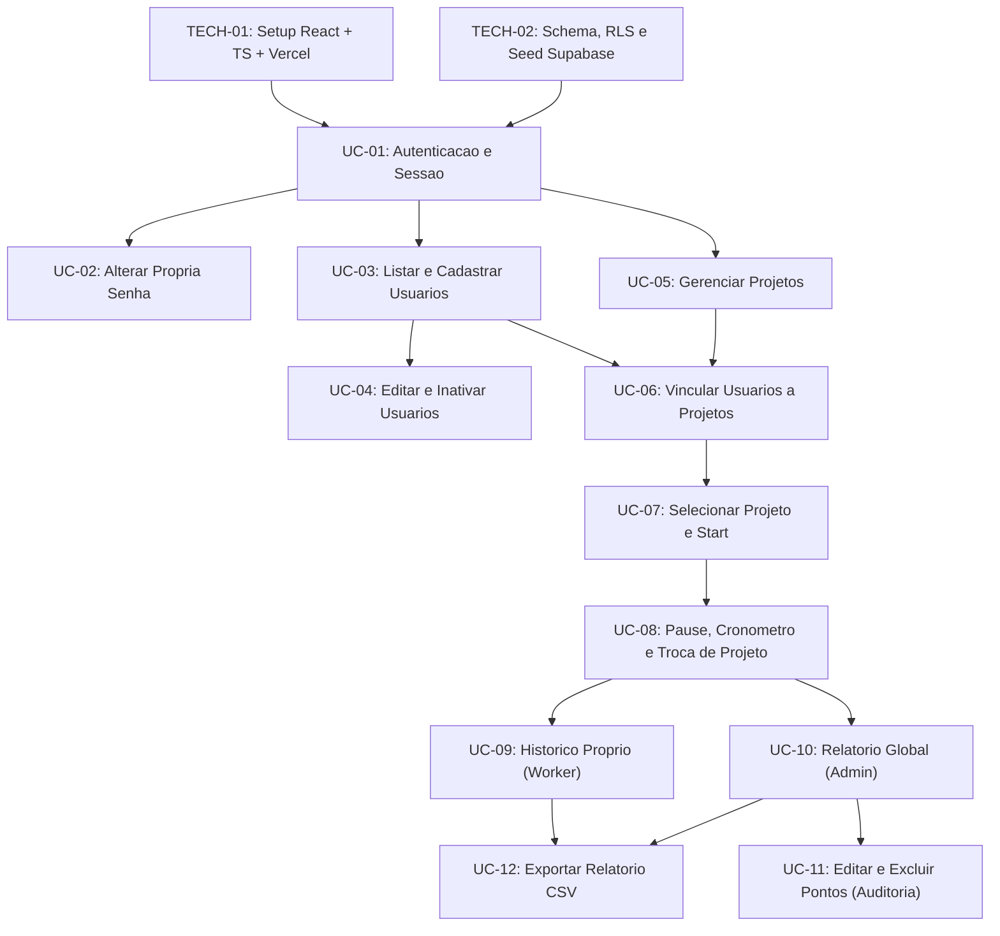
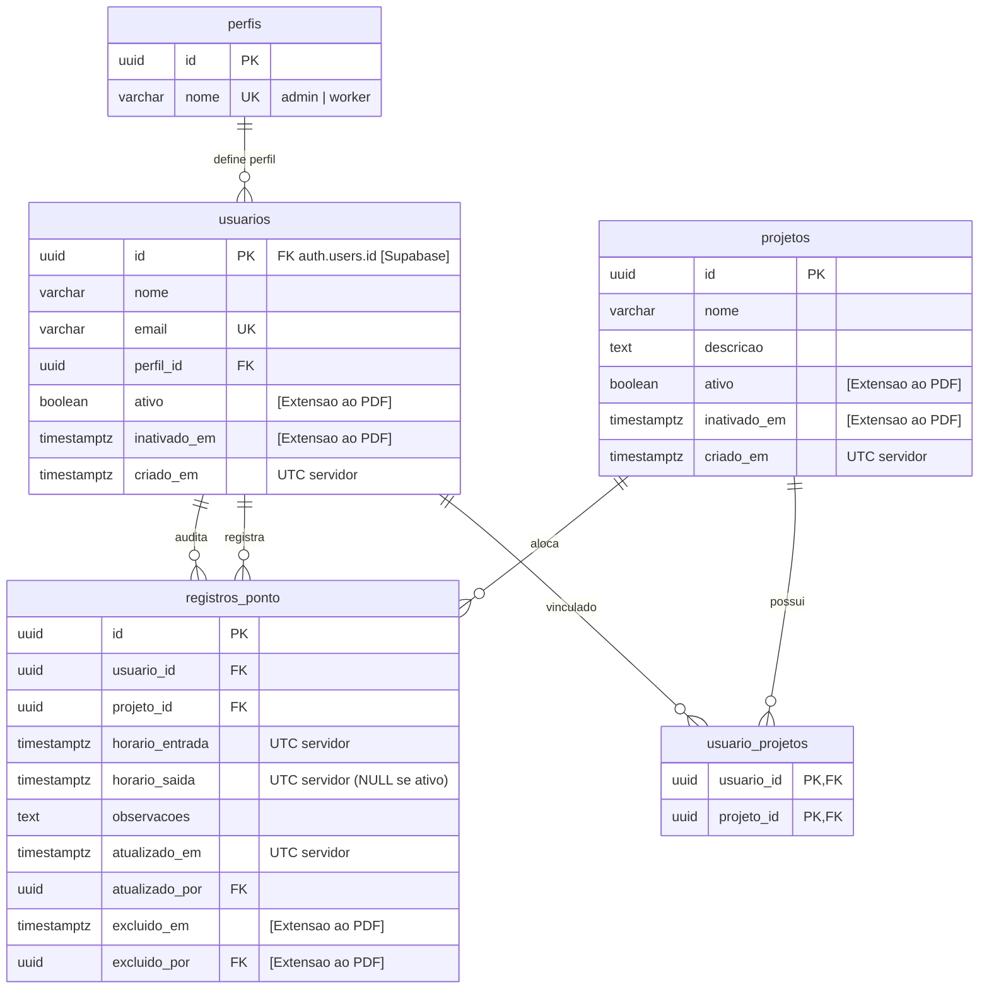

# Especificações e Casos de Uso — Sistema de Controle de Ponto (Projeto Ponto Lelê)

Este diretório consolida a especificação técnica e os casos de uso funcionais derivados de [Especificação de Requisitos - Sistema de Controle de Ponto.pdf](../docs/Especifica%C3%A7%C3%A3o%20de%20Requisitos%20-%20Sistema%20de%20Controle%20de%20Ponto.pdf).

Cada arquivo (`TECH-01`, `TECH-02` e `UC-01` a `UC-12`) foi estruturado na proporção **1 arquivo = 1 Issue no Linear**, contendo:

- **Frontmatter YAML** com metadados prontos para importação no Linear (`team`, `project`, `milestone`, `priority`, `labels`, `estimate`, `blocked_by` e rastreabilidade `RF`/`RN`/`RNF`).
- **Corpo Markdown** autocontido e pronto para ser utilizado diretamente como `description` da issue.

---

## 1. Contexto do Projeto e Alinhamento com o Linear

| Campo | Valor |
| --- | --- |
| **Sistema** | Sistema de Controle de Ponto (Time Tracker para Freelancers) |
| **Time no Linear** | `Ppsilvas` (`PPS`) |
| **Projeto no Linear** | [Projeto Ponto Lelê](https://linear.app/ppsilvas/project/projeto-ponto-lele-18add1b6d501) (`P-PPS-1`) |
| **Perfis de Acesso** | `admin` (Administrador) e `worker` (Trabalhador) |
| **Stack Alvo** | React + TypeScript (`strict: true`), hospedagem Vercel (HTTPS) |
| **Backend / Persistência Alvo** | Supabase (PostgreSQL + Auth + Row Level Security + RPC / Edge Functions) |
| **Labels existentes no Linear** | `Feature`, `Improvement`, `Bug` |

> **Nota sobre Labels:** O campo `linear.labels` em cada spec utiliza apenas labels já existentes no workspace (`Feature`). Tags semânticas adicionais são listadas em `linear.suggested_labels` caso você opte por criá-las posteriormente.

---

## 2. Backlog no Linear (14 Issues / 46 Pontos)

### Milestone 1 — Fundação & Infraestrutura (`M1 - Fundação & Infraestrutura`)

| ID | Linear | Título da Issue | Prioridade | Estimativa | Dependências (`blocked_by`) | Requisitos | Arquivo |
| --- | --- | --- | ---: | ---: | --- | --- | --- |
| `TECH-01` | [PPS-5](https://linear.app/ppsilvas/issue/PPS-5/tech-01-setup-do-projeto-front-end-react-typescript-estrito-deploy) | `[TECH-01] Setup do Projeto Front-end (React + TypeScript Estrito + Deploy Vercel)` | 1 (Urgent) | 3 | — | `RNF01`, `RNF04` | [TECH-01-setup-frontend-vercel.md](./TECH-01-setup-frontend-vercel.md) |
| `TECH-02` | [PPS-6](https://linear.app/ppsilvas/issue/PPS-6/tech-02-modelagem-relacional-politicas-rls-funcoes-server-side-e-seed) | `[TECH-02] Modelagem Relacional, Políticas RLS, Funções Server-Side e Seed no Supabase` | 1 (Urgent) | 5 | — | `RN01`, `RN04`, `RN05`, `RNF02`, `RNF03` | [TECH-02-modelagem-banco-rls-supabase.md](./TECH-02-modelagem-banco-rls-supabase.md) |

### Milestone 2 — Autenticação, Usuários & Projetos (`M2 - Autenticação, Usuários & Projetos`)

| ID | Linear | Título da Issue | Prioridade | Estimativa | Dependências (`blocked_by`) | Requisitos | Arquivo |
| --- | --- | --- | ---: | ---: | --- | --- | --- |
| `UC-01` | [PPS-7](https://linear.app/ppsilvas/issue/PPS-7/uc-01-autenticacao-de-acesso-identificacao-de-perfil-e-controle-de) | `[UC-01] Autenticação de Acesso, Identificação de Perfil e Controle de Sessão` | 1 (Urgent) | 3 | `TECH-01` (`PPS-5`), `TECH-02` (`PPS-6`) | `RF01`, `RNF01`, `RNF02`, `RNF04` | [UC-01-autenticacao-e-controle-sessao.md](./UC-01-autenticacao-e-controle-sessao.md) |
| `UC-02` | [PPS-8](https://linear.app/ppsilvas/issue/PPS-8/uc-02-atualizacao-da-propria-senha) | `[UC-02] Atualização da Própria Senha` | 3 (Medium) | 2 | `UC-01` (`PPS-7`) | `RF02`, `RNF02`, `RNF04` | [UC-02-alteracao-propria-senha.md](./UC-02-alteracao-propria-senha.md) |
| `UC-03` | [PPS-9](https://linear.app/ppsilvas/issue/PPS-9/uc-03-listagem-e-cadastro-de-usuarios-admin) | `[UC-03] Listagem e Cadastro de Usuários (Admin)` | 2 (High) | 5 | `UC-01` (`PPS-7`) | `RF03`, `RNF02`, `RNF03`, `RNF04` | [UC-03-cadastrar-e-listar-usuarios.md](./UC-03-cadastrar-e-listar-usuarios.md) |
| `UC-04` | [PPS-11](https://linear.app/ppsilvas/issue/PPS-11/uc-04-edicao-e-inativacaoexclusao-de-usuarios-com-protecao-do-ultimo) | `[UC-04] Edição e Inativação/Exclusão de Usuários com Proteção do Último Admin` | 2 (High) | 3 | `UC-03` (`PPS-9`) | `RF03`, `RN05`, `RNF02`, `RNF04` | [UC-04-editar-e-inativar-usuarios.md](./UC-04-editar-e-inativar-usuarios.md) |
| `UC-05` | [PPS-10](https://linear.app/ppsilvas/issue/PPS-10/uc-05-cadastro-edicao-e-inativacaoexclusao-de-projetos-admin) | `[UC-05] Cadastro, Edição e Inativação/Exclusão de Projetos (Admin)` | 2 (High) | 3 | `UC-01` (`PPS-7`) | `RF04`, `RNF02`, `RNF03`, `RNF04` | [UC-05-gerenciar-projetos.md](./UC-05-gerenciar-projetos.md) |
| `UC-06` | [PPS-12](https://linear.app/ppsilvas/issue/PPS-12/uc-06-vincular-e-desvincular-usuarios-a-projetos-admin) | `[UC-06] Vincular e Desvincular Usuários a Projetos (Admin)` | 2 (High) | 3 | `UC-03` (`PPS-9`), `UC-05` (`PPS-10`) | `RF04`, `RN02`, `RNF02`, `RNF04` | [UC-06-vincular-usuarios-projetos.md](./UC-06-vincular-usuarios-projetos.md) |

### Milestone 3 — Controle de Ponto (`M3 - Controle de Ponto`)

| ID | Linear | Título da Issue | Prioridade | Estimativa | Dependências (`blocked_by`) | Requisitos | Arquivo |
| --- | --- | --- | ---: | ---: | --- | --- | --- |
| `UC-07` | [PPS-13](https://linear.app/ppsilvas/issue/PPS-13/uc-07-selecao-de-projeto-e-inicio-de-trabalho-start) | `[UC-07] Seleção de Projeto e Início de Trabalho (Start)` | 1 (Urgent) | 3 | `UC-06` (`PPS-12`) | `RF05`, `RF06`, `RN01`, `RN02`, `RNF02`, `RNF03`, `RNF04`, `RNF05` | [UC-07-iniciar-registro-ponto-start.md](./UC-07-iniciar-registro-ponto-start.md) |
| `UC-08` | [PPS-14](https://linear.app/ppsilvas/issue/PPS-14/uc-08-pausaencerramento-de-trabalho-pause-cronometro-ativo-e-troca-de) | `[UC-08] Pausa/Encerramento de Trabalho (Pause), Cronômetro Ativo e Troca de Projeto` | 1 (Urgent) | 3 | `UC-07` (`PPS-13`) | `RF07`, `RN01`, `RN03`, `RNF02`, `RNF03`, `RNF04`, `RNF05` | [UC-08-pausar-registro-ponto-pause-e-troca-projeto.md](./UC-08-pausar-registro-ponto-pause-e-troca-projeto.md) |

### Milestone 4 — Consultas, Auditoria & Exportação (`M4 - Consultas, Auditoria & Exportação`)

| ID | Linear | Título da Issue | Prioridade | Estimativa | Dependências (`blocked_by`) | Requisitos | Arquivo |
| --- | --- | --- | ---: | ---: | --- | --- | --- |
| `UC-09` | [PPS-15](https://linear.app/ppsilvas/issue/PPS-15/uc-09-consulta-de-historico-proprio-e-calculo-de-horas-worker) | `[UC-09] Consulta de Histórico Próprio e Cálculo de Horas (Worker)` | 2 (High) | 3 | `UC-08` (`PPS-14`) | `RF08`, `RNF02`, `RNF03`, `RNF04` | [UC-09-consultar-historico-ponto-worker.md](./UC-09-consultar-historico-ponto-worker.md) |
| `UC-10` | [PPS-16](https://linear.app/ppsilvas/issue/PPS-16/uc-10-consulta-global-de-registros-de-ponto-e-totalizacao-de-horas) | `[UC-10] Consulta Global de Registros de Ponto e Totalização de Horas (Admin)` | 2 (High) | 3 | `UC-08` (`PPS-14`) | `RF08`, `RNF02`, `RNF03`, `RNF04` | [UC-10-consultar-relatorio-pontos-admin.md](./UC-10-consultar-relatorio-pontos-admin.md) |
| `UC-11` | [PPS-17](https://linear.app/ppsilvas/issue/PPS-17/uc-11-edicao-e-exclusao-administrativa-de-registros-de-ponto-com) | `[UC-11] Edição e Exclusão Administrativa de Registros de Ponto com Auditoria` | 2 (High) | 5 | `UC-10` (`PPS-16`) | `RF08`, `RN01`, `RN04`, `RNF02`, `RNF03`, `RNF04` | [UC-11-editar-e-excluir-registros-ponto-auditoria.md](./UC-11-editar-e-excluir-registros-ponto-auditoria.md) |
| `UC-12` | [PPS-18](https://linear.app/ppsilvas/issue/PPS-18/uc-12-exportacao-de-registros-de-ponto-em-csv) | `[UC-12] Exportação de Registros de Ponto em CSV` | 3 (Medium) | 2 | `UC-09` (`PPS-15`), `UC-10` (`PPS-16`) | `RF08`, `RNF02`, `RNF04` | [UC-12-exportar-relatorio-csv.md](./UC-12-exportar-relatorio-csv.md) |

---

## 3. Grafo de Dependências

---

## 4. Modelo de Dados Consolidado e Extensões ao PDF

### 4.1 Diagrama Entidade-Relacionamento

### 4.2 Tabela Comparativa: Schema do PDF vs. Extensões Propostas (`[Extensão ao PDF]`)

| Tabela | Origem PDF (Seção 5) | Extensão / Adaptação Proposta | Justificativa de Engenharia |
| --- | --- | --- | --- |
| `usuarios` | `id`, `nome`, `email`, `senha_hash`, `perfil_id`, `criado_em` | `id` referencia `auth.users(id)`; `senha_hash` delegada ao Supabase Auth (`auth.users.encrypted_password`). Adição de `ativo BOOLEAN DEFAULT true` e `inativado_em TIMESTAMPTZ` (`[Extensão ao PDF]`). | Habilita `auth.uid()` para RLS (`RNF02`) sem duplicar credenciais; viabiliza *"excluir/inativar usuários"* (`RF03`) e *"único admin ativo"* (`RN05`) preservando histórico e auditoria. |
| `projetos` | `id`, `nome`, `descricao`, `criado_em` | Adição de `ativo BOOLEAN DEFAULT true` e `inativado_em TIMESTAMPTZ` (`[Extensão ao PDF]`). | Impede quebra de integridade referencial e perda de relatórios de `registros_ponto` históricos ao remover projetos, bloqueando apenas novas batidas. |
| `registros_ponto` | `id`, `usuario_id`, `projeto_id`, `horario_entrada`, `horario_saida`, `observacoes`, `atualizado_em`, `atualizado_por` | Adição de `excluido_em TIMESTAMPTZ` e `excluido_por UUID REFERENCES usuarios(id)` (`[Extensão ao PDF]`). | Atende *"excluir registros de ponto (com log de auditoria)"* (Seção 2 e `RF08`); uma exclusão física (`DELETE`) apagaria a trilha de auditoria. |

---

## 5. Matriz de Rastreabilidade Completa

### 5.1 Requisitos Funcionais (`RF01`–`RF08`)

| Código | Requisito (PDF) | Specs / Casos de Uso |
| --- | --- | --- |
| `RF01` | Autenticação de Acesso | `UC-01` |
| `RF02` | Atualização de Senha | `UC-02` |
| `RF03` | Gestão de Usuários (Admin) | `UC-03`, `UC-04` |
| `RF04` | Gestão de Projetos (Admin) | `UC-05`, `UC-06` |
| `RF05` | Seleção de Projeto no Ponto | `UC-07` |
| `RF06` | Início de Trabalho (Start) | `UC-07` |
| `RF07` | Pausa / Fim de Trabalho (Pause) | `UC-08` |
| `RF08` | Consulta, Cálculo e Gestão de Pontos | `UC-09`, `UC-10`, `UC-11`, `UC-12` |

### 5.2 Regras de Negócio (`RN01`–`RN05`)

| Código | Regra de Negócio (PDF) | Garantida em (Banco / UI / UCs) |
| --- | --- | --- |
| `RN01` | Unicidade de Sessão Ativa | `TECH-02` (índice único parcial), `UC-07`, `UC-08`, `UC-11` |
| `RN02` | Restrição de Vínculo com Projeto | `UC-06`, `UC-07` (RPC + validação UI) |
| `RN03` | Troca de Projeto Durante o Expediente | `UC-08` |
| `RN04` | Integridade Cronológica e Auditoria | `TECH-02` (`CHECK` + trigger auditoria), `UC-11` |
| `RN05` | Proteção do Último Administrador | `TECH-02` (trigger atômico), `UC-04` |

### 5.3 Requisitos Não Funcionais (`RNF01`–`RNF05`)

| Código | Requisito Não Funcional (PDF) | Specs / Casos de Uso |
| --- | --- | --- |
| `RNF01` | Arquitetura Front-end e Deploy (React + TS estrito + Vercel HTTPS) | `TECH-01`, `UC-01` (transversal a todos os UCs) |
| `RNF02` | Controle de Autorização e Segurança (RLS + Hash criptográfico) | `TECH-02`, `UC-01` a `UC-12` |
| `RNF03` | Sincronismo de Horário no Servidor (UTC) | `TECH-02`, `UC-03`, `UC-05`, `UC-07`, `UC-08`, `UC-09`, `UC-10`, `UC-11` |
| `RNF04` | Responsividade (Desktop + Mobile Start/Pause rápido) | `TECH-01`, `UC-01` a `UC-12` |
| `RNF05` | Usabilidade e Feedback Visual (Projeto ativo, início e cronômetro real-time) | `UC-07`, `UC-08` |

### 5.4 Matriz de Permissões (Seção 2 do PDF)

| Funcionalidade / Ação | Admin | Worker | Cobertura |
| --- | --- | --- | --- |
| Autenticação e troca da própria senha | Permitido | Permitido | `UC-01`, `UC-02` |
| Cadastrar, editar e excluir usuários | Permitido | Não permitido | `UC-03`, `UC-04`, `TECH-02` (RLS) |
| Cadastrar, editar e excluir projetos | Permitido | Não permitido | `UC-05`, `TECH-02` (RLS) |
| Vincular e desvincular usuários a projetos | Permitido | Não permitido | `UC-06`, `TECH-02` (RLS) |
| Registrar ponto (`Start` / `Pause`) com observação | Permitido (se vinculado) | Permitido (apenas nos seus projetos) | `UC-07`, `UC-08`, `TECH-02` (RLS/RPC) |
| Consultar registros de ponto | Todos os usuários e projetos | Apenas os próprios registros | `UC-09`, `UC-10`, `UC-12`, `TECH-02` (RLS) |
| Editar ou excluir registros de ponto | Permitido (com log de auditoria) | Não permitido | `UC-11`, `TECH-02` (RLS/RPC) |

---

## 6. Sincronização com o Linear

Todas as **4 milestones** e **14 issues** (`PPS-5` a `PPS-18`) já estão criadas e vinculadas no projeto [Projeto Ponto Lelê](https://linear.app/ppsilvas/project/projeto-ponto-lele-18add1b6d501) (`P-PPS-1`, time `Ppsilvas` / `PPS`) com suas respectivas relações `blockedBy`:

- **M1 - Fundação & Infraestrutura:** `PPS-5` (`TECH-01`), `PPS-6` (`TECH-02`)
- **M2 - Autenticação, Usuários & Projetos:** `PPS-7` (`UC-01`), `PPS-8` (`UC-02`), `PPS-9` (`UC-03`), `PPS-10` (`UC-05`), `PPS-11` (`UC-04`), `PPS-12` (`UC-06`)
- **M3 - Controle de Ponto:** `PPS-13` (`UC-07`), `PPS-14` (`UC-08`)
- **M4 - Consultas, Auditoria & Exportação:** `PPS-15` (`UC-09`), `PPS-16` (`UC-10`), `PPS-17` (`UC-11`), `PPS-18` (`UC-12`)

Para manter as specs e o Linear alinhados em evoluções futuras:
1. Atualize primeiro o arquivo correspondente em `specs/` (frontmatter YAML + corpo Markdown).
2. Sincronize a issue existente no Linear usando `save_issue(id="PPS-XX", ...)` preservando os metadados de `milestone`, `priority`, `estimate`, `labels` e `blockedBy`.
